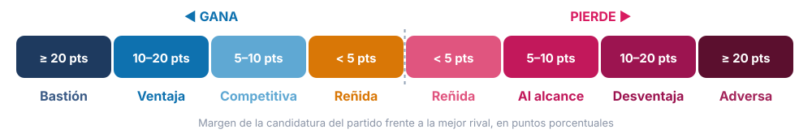

<div align="center">


<br>


**Cada resultado electoral de México, del país a la sección, en un solo lugar y medido con el mismo rigor.**

[Qué mide](#-qué-mide) · [Hallazgos](#-lo-que-ya-dicen-los-datos) · [Cobertura](#-cobertura) · [Confianza](#-cada-dato-con-su-nivel-de-confianza) · [Fuentes](#-fuentes)

</div>

---

## ✦ Qué es

**Argos · Electoral** convierte décadas de actas, cómputos y padrones en lecturas claras. Responde, para cualquier territorio y cualquier cargo:

> **¿Quién gana aquí y por cuánto? ¿Qué tan disputado está? ¿Quién vota? ¿Este lugar se mueve con el país o va por su cuenta? ¿Hasta dónde puede llegar un partido?**

La unidad de análisis es la **sección electoral**, el territorio más pequeño con resultados oficiales. Desde ahí todo se agrega a municipio, distrito, entidad y país.

<table>
<tr>
<td align="center" width="20%"><h3>🗳️</h3><b>Presidencia</b><br><sub>2000–2024 por sección<br>desde 1964 por entidad</sub></td>
<td align="center" width="20%"><h3>🏛️</h3><b>Senado y diputaciones</b><br><sub>1994–2024 por sección<br>300 distritos federales</sub></td>
<td align="center" width="20%"><h3>🏙️</h3><b>Gubernaturas y congresos locales</b><br><sub>2015–2024 por sección</sub></td>
<td align="center" width="20%"><h3>🏘️</h3><b>Ayuntamientos</b><br><sub>1970–2025 por municipio<br>1994–2025 por sección</sub></td>
<td align="center" width="20%"><h3>⚖️</h3><b>Poder Judicial 2025</b><br><sub>federal y 19 estados<br>voto por persona</sub></td>
</tr>
</table>

---

## ◆ Qué mide

### 1 · Resultados, leídos de cuatro maneras

Una misma elección cambia según cómo se cuenten las coaliciones. Argos ofrece las cuatro lecturas:

| Lectura | Pregunta que responde |
|---|---|
| **Por candidatura** | ¿Cuántos votos obtuvo cada candidatura, sumando partido y coalición? |
| **Por boleta** | ¿Cuántos votos recibió cada recuadro tal como aparece en la boleta? |
| **Alcance de partido** | ¿Cuántos votos pasaron por un partido, solo o en alianza? |
| **Por bloque** | ¿Cómo se reparte el voto entre grandes fuerzas comparables entre años? |

### 2 · Competencia

<div align="center"></div>

- **Margen de victoria y competitividad.** Clasifica cada entidad, distrito, municipio o sección en bastión, ventaja, competitiva o reñida.
- **🎯 Partido de enfoque.** Con un selector, toda la plataforma se lee desde Morena, PAN, PRI o MC. Cada territorio pasa a ser *ganado* o *perdido* para ese partido, y con qué margen.
- **Número efectivo de partidos.** ¿Compiten realmente dos fuerzas, tres o una sola domina?
- **Volatilidad.** ¿Qué porcentaje del voto cambió de partido respecto de la elección anterior?
- **Continuidad o alternancia.** ¿La misma fuerza gana elección tras elección?

### 3 · Participación y electorado

- **Participación** por territorio y su cambio frente a la elección anterior.
- **Pirámide del electorado** por sexo y **12 rangos de edad** (18, 19, 20-24 … 65+), hasta el nivel de sección.
- **¿Quién vota?** Relación entre la edad o el sexo del electorado de cada sección y su participación: ¿votan más las secciones jóvenes o las envejecidas?

### 4 · Tendencia: ¿este lugar sigue al país?

Para cada una de las **72,895 secciones** con historia suficiente:

| Medición | Qué dice |
|---|---|
| **Sigue / parcial / independiente** | Si, cuando el país se mueve hacia una fuerza, la sección se mueve en la misma dirección |
| **Amplifica o amortigua** | Si la sección exagera la ola nacional o la suaviza |
| **Distancia a la media nacional** | Cuántos puntos de voto la separan del reparto del país y del de su estado |
| **Arrastre o voto diferenciado** | Si en un año con varias boletas vota igual para todos los cargos o divide su voto |
| **Posición relativa** | Cómo se compara con las demás secciones de su municipio, su estado y el país |

### 5 · Piso, techo y votos aspirables

Para cada partido, en cualquier territorio y cargo, sobre las **últimas 5 o 10 elecciones**:

```
  piso ●━━━━━━━━━━━━━━━━━━━━━━━━━━━━━━━━━━━━━━━━━━━● techo
           │                  ◉ última elección
        promedio
```

- **Piso y techo**: el peor y el mejor resultado, con su año.
- **Votos aspirables hoy**: ese rango proyectado sobre la lista nominal actual. Es una referencia realista de hasta dónde puede crecer o caer un partido.
- Dos medidas: **con aliados** (la candidatura completa) o **votos propios** (solo su recuadro).

### 6 · Estrategia sección por sección

Compara dos elecciones, del mismo cargo en años distintos o de cargos distintos el mismo año, y clasifica cada sección para un partido:

| | Clase | Situación | Acción sugerida |
|:-:|---|---|---|
| 🟦 | **Bastión** | Gana en ambas por 10+ puntos | Conservar con poca inversión |
| 🔷 | **Ganada reñida** | Gana en ambas por menos de 10 | Blindar: defensa del voto |
| 🟪 | **Conquista nueva** | Antes perdía, hoy gana | Consolidar al votante nuevo |
| 🟥 | **Perdida** | Antes ganaba, hoy pierde | Recuperar: diagnóstico de la caída |
| 🟧 | **Objetivo al alcance** | Pierde en ambas por menos de 10 | Persuadir y movilizar: mejor costo-beneficio |
| ⬜ | **Adversa** | Pierde en ambas por 10+ puntos | Baja prioridad |

Para cada sección calcula además **cuántos votos faltan para ganar**, la ventaja que se tiene y el **potencial por participación**: cuántos votos habría si la sección votara como la mediana. Todo se descarga en CSV.

### 7 · Elección judicial 2025

Una elección sin partidos, donde se vota por personas y cada elector marca varias candidaturas. Argos muestra a cada candidata y candidato con su lugar y su porcentaje dentro de su ámbito, del país a la sección.

---

## ◇ Lo que ya dicen los datos

<table>
<tr>
<td width="33%" valign="top">

### 0.72 vs 0.57
Las secciones **siguen más a su estado que al país**. La correlación típica de sus cambios es 0.72 con su estado y 0.57 con el país: la política local pesa.

</td>
<td width="33%" valign="top">

### 21 · 56 · 19 %
De las secciones con historia suficiente, el **21%** sigue la tendencia nacional, el **56%** la sigue parcialmente y el **19%** se comporta de forma independiente.

</td>
<td width="33%" valign="top">

### 38 % vs 24 %
En años con varias boletas, las secciones **dividen su voto** (38% de los casos) más a menudo de lo que **votan en bloque** (24%), comparadas con su estado.

</td>
</tr>
</table>

---

## ▣ Cobertura

| Cargo | Por sección | Por municipio, distrito o entidad |
|---|:-:|:-:|
| Presidencia | 2000 – 2024 | 1964 – 2024 |
| Senado | 1994 – 2024 | 1964 – 2024 |
| Diputaciones federales | 1994 – 2024 | 1979 – 2024 |
| Gubernaturas | 2015 – 2024 | 1961 – 2024 |
| Diputaciones locales | 2015 – 2024 | 1979 – 2024 |
| Ayuntamientos | 1994 – 2025 | 1970 – 2025 |
| Poder Judicial (federal y local) | 2025 | 2025 |
| Lista nominal por sexo | 2017 – 2026 | 1991 – 2003 |
| Lista nominal por edad y sexo | 2021 – 2026 | |

---

## ◎ Cada dato con su nivel de confianza

Ninguna cifra se da por buena solo porque «cuadra». Cada elección se contrasta con **una segunda fuente independiente** y recibe una etiqueta visible en la plataforma:

| | Nivel | Significado |
|:-:|---|---|
| 🟢 | **Alta** | Oficial, internamente consistente y confirmada por otra fuente |
| 🔵 | **Media** | Oficial e internamente consistente, sin segunda fuente disponible |
| 🟡 | **Baja** | Inconsistencias menores o diferencias de 2–10% con otra fuente |
| 🔴 | **No usar** | Imputada, duplicada o con diferencias mayores al 10% |

Las **lecturas analíticas** (bloques, candidaturas inferidas, tendencias, pisos y techos, estrategia) se distinguen siempre de los **resultados oficiales** y muestran su método.

---

## ◈ Fuentes

| | |
|---|---|
| **Instituto Nacional Electoral** | Cómputos distritales federales y de la elección judicial; estadística de elecciones locales (SICEE); padrón y lista nominal (DERFE) |
| **Eric Magar** · [`elecRetrns`](https://github.com/emagar/elecRetrns) · [`mxDistritos`](https://github.com/emagar/mxDistritos) | Resultados históricos por casilla, municipio, distrito y entidad; equivalencias de secciones desde 1994 |
| **Bruno Calderón** · [base municipal por sección](https://github.com/brunocalderonh/The-Mexican-municipal-elections-electoral-precinct-level-database) | Ayuntamientos por sección 1994–2025 |

<sub>Las cifras corresponden a los cómputos oficiales en su fecha de corte, antes de resoluciones posteriores del Tribunal Electoral, salvo donde se indica. Las secciones cambian con el tiempo por reseccionamiento; las comparaciones entre años lo advierten.</sub>

---

<div align="center">

**Argos · Electoral** · acceso con usuario · guía de desarrollo en [`docs/DESARROLLO.md`](docs/DESARROLLO.md)

<sub>Hecho en México 🇲🇽</sub>

</div>
